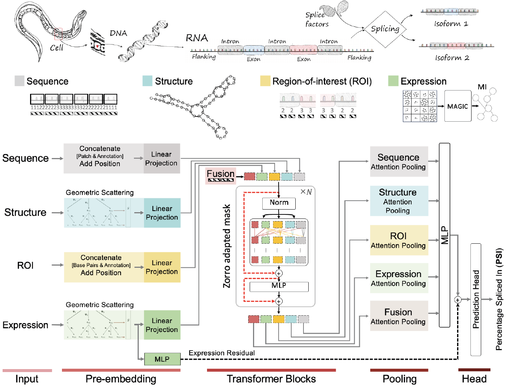

# CellSpliceNet: Interpretable Multimodal Modeling of Alternative Splicing Across Neurons in *C. elegans*

[](https://www.python.org/)
[](https://pytorch.org/)
[](https://developer.nvidia.com/cuda-toolkit)
[](#requirements)
[](#license)

> **CellSpliceNet** is an interpretable transformer-based multimodal deep learning framework that predicts splicing outcomes across neurons in *C. elegans* by integrating four complementary data modalities.

**Authors:** Arman Afrasiyabi, Jake Kovalic, Chen Liu, Egbert Castro, Alexis Weinreb, Erdem Varol, David M. Miller III, Marc Hammarlund, Smita Krishnaswamy

**Quick links:**
📄 [Preprint (bioRxiv)](https://www.biorxiv.org/content/10.1101/2025.06.22.660966v1) · 🧪 [Dataset](https://github.com/KrishnaswamyLab/CellSpliceNet-dataset) · 💻 [Repo](https://github.com/KrishnaswamyLab/CellSpliceNet)

---

## Abstract

We introduce CellSpliceNet, an interpretable transformer-based multimodal deep learning framework designed to predict splicing outcomes across the neurons of *C. elegans*. By integrating four complementary data modalities—(1) long-range genomic sequence, (2) local regions of interest (ROIs) in the RNA sequence, (3) secondary structure, and (4) gene expression—CellSpliceNet captures the complex interplay of factors that influence splicing decisions within the cellular context. CellSpliceNet employs modality-specific transformer embeddings, incorporating structural representations guided by mutual information and scattering graph embeddings. A carefully designed multimodal multi-head attention mechanism preserves the integrity of each modality while enabling selective cross-modal interactions (e.g., allowing gene expression to inform sequence/structure signals). Attention-based pooling within each modality highlights biologically critical elements, such as canonical intron–exon splice boundaries and accessible single-stranded RNA loop structures within exons.

<p align="center">
  
</p>

---

## Highlights

- **Multimodal fusion:** sequence (global + ROI), secondary structure, and gene expression.
- **Interpretable attention:** modality-specific pooling surfaces biologically relevant signals (e.g., splice boundaries, loop accessibility).
- **Selective cross-modal attention:** preserves modality integrity while enabling targeted information flow.

---

## Table of Contents

- [Repository Structure](#repository-structure)
- [Requirements](#requirements)
- [Installation](#installation)
- [Data: Download & Configure](#data-download--configure)
- [Quickstart: Train & Validate](#quickstart-train--validate)
- [Pretrained Weights](#pretrained-weights)
- [Troubleshooting](#troubleshooting)
- [Contributing](#contributing)
- [License](#license)
- [Citation](#citation)

---

## Repository Structure

```
CellSpliceNet/
  src/
    data/           # datasets + dataloaders
    models/         # model definitions (transformers, heads, etc.)
    nn/             # neural modules and layers
    utils/          # logging, seeding, config helpers, misc
    viz/            # visualization utilities for results/attention maps
    train_full.py   # step-based trainer (recommended); train.py = legacy epoch loop
    eval.py         # per-row predictions for a checkpoint
  processing/       # builds the data root from raw data (worm, human, structure)
  splits/           # split builder + specs (writes <data_root>/<organism>/splits/<name>/)
  experiments/      # Slurm drivers and analysis scripts (see experiments/README.md)
  requirements-train.txt
  LICENSE
  README.md
```

---

## Requirements

- **OS:** Linux with an NVIDIA GPU (CUDA 12.8 driver)
- **Python:** 3.10
- **Dependencies:** `requirements-train.txt` (PyTorch 2.11, pinned); `requirements.txt` is the original 2023 environment

---

## Installation

```bash
git clone https://github.com/KrishnaswamyLab/CellSpliceNet && cd CellSpliceNet
uv venv --python 3.10 csn && source csn/bin/activate
uv pip install -r requirements-train.txt --index-strategy unsafe-best-match
```

Comparison baselines need extra packages (e.g. `spliceai-pytorch`, `transformers`).

---

## Data: Download & Configure

1. Download the dataset: **[CellSpliceNet-dataset](https://github.com/KrishnaswamyLab/CellSpliceNet-dataset)**
2. Point the code at it: `export CSN_DATA_ROOT=/path/to/data_root` (or put it at `<repo>/dataset`).
   The data root has `c_elegans/` and `human/`, each with `processed/`, `raw/` and `splits/<name>/`
   (`train.csv`, `valid.csv`, `test.csv`, `data_config.ini`). Rebuild or extend it with `processing/` and `splits/`.

Every split's **`data_config.ini`** lists its files (`[files]` section) using `$DATASET` (data root) and
`$CONFIG_DIR` (the split folder), so no paths are hardcoded.

See **[TRAINING.md](TRAINING.md)** for the full layout and path tokens.

---

## Quickstart: Train & Validate

The recommended trainer is **`src/train_full.py`** (sample/step budgeted). `src/train.py` is the legacy epoch-based loop. `--data_tag` picks the organism and its default (paper) split; pass `--config_fname <data_root>/<organism>/splits/<split>/data_config.ini` for any other split:

| Dataset | `--data_tag` | Default split |
|---------|--------------|---------------|
| Worm (*C. elegans*) | `replicate` (default) | `c_elegans/splits/rows_se` (skipped exons; released checkpoint) |
| Human (GTEx) | `gtex` | `human/splits/gene` (gene-disjoint) |

On Slurm, `experiments/common/train.sbatch` wraps the same trainer (`SPLIT=gene MODEL=deltacellsplicenet SEED=1 sbatch experiments/common/train.sbatch`).

### Run on human (GTEx) data

```bash
python src/train_full.py \
    --data_tag gtex \
    --sfgenes 493 \
    --batch_size 4 \
    --n_steps 200000
```

### Run on worm (*C. elegans*) data

```bash
python src/train_full.py \
    --data_tag replicate \
    --sfgenes 243 \
    --batch_size 16 \
    --n_steps 200000
```

GPU memory: batch 16 (worm) and batch 4-8 (human) fit a 40 GB A100; a 24 GB card runs out of memory on worm at batch 16.

Checkpoints and metrics go to `<repo>/outputs/<model>/<run-key>/`. See **[TRAINING.md](TRAINING.md)** for run-budget knobs, expression encoders, and outputs.

---

## Comparison baselines

Sequence-only baselines live under `comparisons/` (ESM2, Evo2, Pangolin, SpliceAI, SpliceBERT, SpliceFinder, SpliceTransformer, ViT). They use the same `data_config.ini` flow as `train_full.py` via `--data-tag replicate` or `--data-tag gtex`.

```bash
cd comparisons/ESM2
python train_test_ESM2.py --data-tag replicate --random-seed 1 --batch-size 64 --num-workers 4
```

Results: `comparisons/results/<Method>/log_<data_tag>_seed-<N>.txt`.
---

## Pretrained Weights

A pretrained model is available here: **[CellSpliceNet.pth](https://drive.google.com/drive/folders/1pVfKlGspW1sOB1W-rr9SQD_qas4u8uhy?usp=drive_link)**.
Download the weights and point your configuration/checkpoint loader to the file path per your setup.

---

## Troubleshooting

- **CUDA mismatch / “CUDA driver version is insufficient”:**
  Ensure your installed PyTorch build matches your system CUDA (or use the CPU build).
- **Out of GPU memory:**
  Reduce `batch_size` and/or sequence length; consider gradient accumulation or mixed precision (AMP).
- **Dataset path errors:**
  Check `dataset/<species>/data_config.ini` and that `$CONFIG_DIR` paths exist on disk.
- **Image not rendering in README:**
  Confirm the filename is exactly `CellSplceNet.png` in the repository root (case-sensitive on Linux).

---

## Other implementation details
All experiments are conducted on a single A100 GPU. Data loading and preprocessing pipelines are implemented with standard libraries. Reproducibility is ensured via fixed random seeds and environment specification. Preprocessing scripts, end-to-end training and inference scripts, and pretrained model checkpoints are available in the public repository.

We partitioned the data with a row-level IID random split into training (65\%), validation (15\%), and test (20\%) by drawing a uniform random assignment for each observation. To assess robustness, we additionally performed k-fold cross-validation and repeated the entire training/testing procedure ten independent times with different random seeds. All preprocessing and partitioning scripts are available in the repository under the preprocessing (pp/) folder. To prevent leakage, all normalizers/tokenizers were fit on train only; genomic windows/ROIs were generated once and constrained to not cross splits; augmentation was train-only; and early stopping/hyperparameters were selected on validation with the test set revealed once at the end.

---

## Contributing

Contributions are welcome! Please open an issue to discuss major changes. For pull requests:
1. Fork the repo and create a feature branch.
2. Add or update tests if applicable.
3. Ensure style/formatting is consistent.
4. Open a PR with a clear description and motivation.

---

## License

This project is distributed under the terms specified in the **[LICENSE](https://github.com/KrishnaswamyLab/CellSpliceNet/blob/main/LICENSE.md)** file.

---

## Citation

If you use this repository, models, or ideas in your research, please cite:

```bibtex
@article{Afrasiyabi2025CellSpliceNet,
  title   = {CellSpliceNet: Interpretable Multimodal Modeling of Alternative Splicing Across Neurons in C. elegans},
  author  = {Afrasiyabi, Arman and Kovalic, Jake and Liu, Chen and Castro, Egbert and Weinreb, Alexis and Varol, Erdem and Miller, David M., III and Hammarlund, Marc and Krishnaswamy, Smita},
  journal = {bioRxiv},
  year    = {2025},
  doi     = {10.1101/2025.06.22.660966},
  url     = {https://www.biorxiv.org/content/10.1101/2025.06.22.660966v1}
}
```
